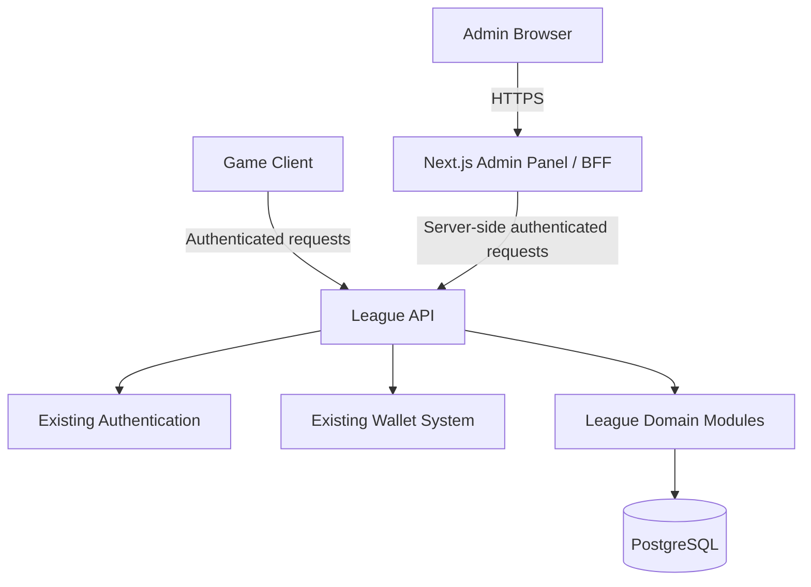
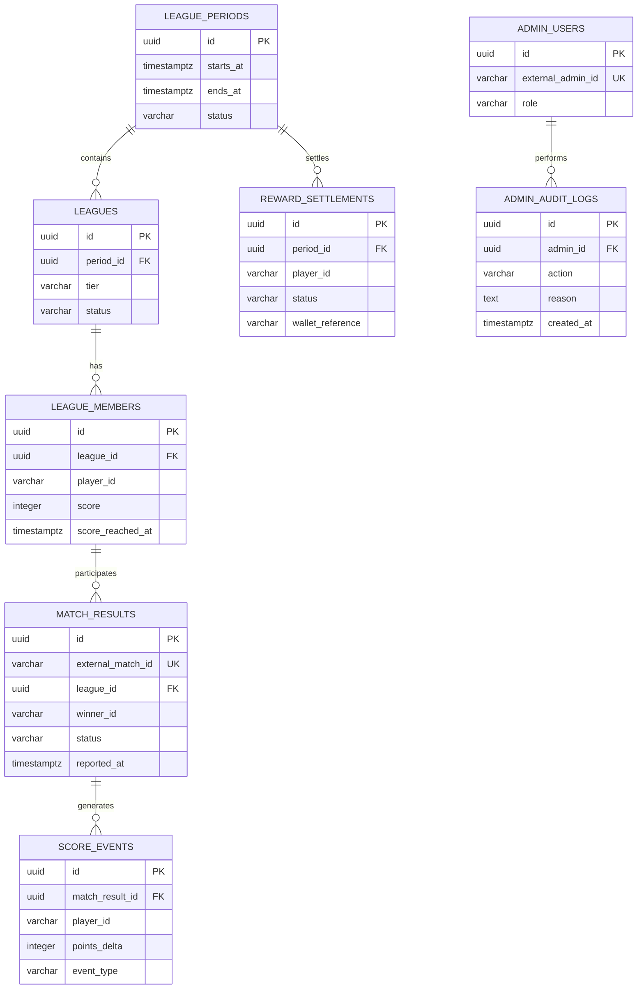

# Hexabout Leagues — Technical Design

**Status:** Draft v0.2

## 1. Architecture Overview

The system uses a modular monolith architecture built with Node.js, TypeScript, Express, and PostgreSQL. This keeps deployment and operational complexity low while separating business responsibilities into focused modules.

### Core Components

- **Game Client:** Submits match-result reports and requests player league data.
- **League API:** Handles authentication integration, request validation, league operations, result processing, leaderboard queries, and administrative actions.
- **PostgreSQL:** Stores league periods, leagues, memberships, match results, score events, reward settlement records, and administrative audit logs.
- **Next.js Admin Panel:** Provides the administrative interface and acts as a Backend-for-Frontend (BFF).
- **External Authentication and Wallet Systems:** Existing platform capabilities that may be integrated through documented interfaces. Their exact contracts must be confirmed.

### Request Flow

**Player flow:**

1. The game client sends an authenticated request to the League API.
2. The API validates the request and verifies player ownership.
3. The relevant service executes the business operation.
4. PostgreSQL persists the operation using constraints and transactions.
5. The API returns a validated response.

**Admin flow:**

1. The browser sends requests to the Next.js server.
2. The Next.js server validates the administrator session.
3. The server-side API client sends requests to the League API.
4. The API independently authenticates and authorizes the administrator.
5. The operation and its audit record are persisted transactionally.
6. The result is returned through the Next.js server to the browser.

The browser never communicates directly with the internal League API.

### Architecture Diagram



### Architectural Decisions

| Decision | Rationale |
|---|---|
| Modular monolith | Simple deployment with clear business boundaries |
| PostgreSQL | Transactions, relational constraints, and reliable persistence |
| Next.js BFF | Keeps API credentials and session handling server-side |
| TypeScript | Safer contracts and refactoring |
| Runtime validation | Rejects invalid request and response data |
| Transactional score updates | Prevents duplicate and inconsistent score changes |

### Initial Backend Modules

- Authentication and authorization
- League management
- League membership and assignment
- Match-result processing
- Leaderboard queries
- Administrative moderation
- Reward settlement
- Audit logging

Modules communicate through explicit service interfaces. Business rules are not duplicated across route handlers or frontend components.

## 2. Data Model

The initial relational model contains the following tables:

| Table | Responsibility |
|---|---|
| `league_periods` | Weekly competition periods |
| `leagues` | Groups participating in each period |
| `league_members` | Player membership and current score |
| `match_results` | Reported match results and their status |
| `score_events` | Auditable score changes |
| `admin_users` | Seeded administrators and their roles |
| `admin_audit_logs` | Administrative action history |
| `reward_settlements` | Idempotent reward settlement tracking |

Player IDs are stored as external identifiers because the existing platform already owns player accounts and authentication.

### Entity Relationships



### Important Constraints and Indexes

| Constraint / Index | Purpose |
|---|---|
| `UNIQUE(period_id, player_id)` on league membership | Prevents duplicate membership in a period |
| `UNIQUE(external_match_id)` on match results | Makes match reporting idempotent |
| `UNIQUE(match_result_id, player_id, event_type)` on score events | Prevents duplicate score changes |
| `UNIQUE(period_id, player_id)` on reward settlements | Prevents duplicate reward settlement |
| `(league_id, score DESC, score_reached_at ASC, player_id ASC)` | Supports deterministic leaderboard ordering |
| `(period_id, status)` on leagues | Supports filtering leagues by period and status |
| `(target_type, target_id, created_at DESC)` on audit logs | Supports moderation history queries |

The leaderboard uses score descending, then the time the player reached their current score, then player ID as a deterministic tie-breaker.

### Important Queries

**Leaderboard — maximum 50 players:**

```sql
SELECT player_id, score, score_reached_at
FROM league_members
WHERE league_id = $1
ORDER BY score DESC, score_reached_at ASC, player_id ASC
LIMIT 50;
```

**Paginated current leagues:**

The API uses cursor-based pagination instead of large offsets. This avoids increasingly expensive queries as the dataset grows.

```sql
SELECT id, period_id, tier, status, created_at
FROM leagues
WHERE status = 'active'
  AND ($1::timestamptz IS NULL OR created_at < $1)
ORDER BY created_at DESC, id DESC
LIMIT $2;
```

The production query should use a composite cursor containing both `created_at` and `id` to ensure stable pagination.

## 3. API Design

All endpoints use the `/api/v1` prefix and a consistent JSON response envelope.

### Player Endpoints

| Method | Endpoint | Purpose |
|---|---|---|
| `POST` | `/api/v1/matches/results` | Report a match result idempotently |
| `GET` | `/api/v1/me/leagues` | Retrieve the player's current leagues |
| `GET` | `/api/v1/leagues/:leagueId/leaderboard` | Retrieve up to 50 leaderboard entries |

### Admin Endpoints

| Method | Endpoint | Purpose |
|---|---|---|
| `POST` | `/api/v1/admin/auth/login` | Authenticate a seeded administrator |
| `GET` | `/api/v1/admin/leagues` | Retrieve paginated leagues |
| `GET` | `/api/v1/admin/leagues/:leagueId/leaderboard` | Inspect a league leaderboard |
| `POST` | `/api/v1/admin/matches/:matchId/void` | Void a reported match result |

### Result Reporting

A result report includes an external match ID, the relevant league ID, and the reported match outcome.

The API uses the external match ID as an idempotency key. A unique database constraint prevents duplicate processing. Repeated requests return the existing result without awarding points again.

Client-reported results are untrusted input. Without an authoritative match server or verifiable match evidence, the system cannot guarantee that a reported result is genuine. This limitation must be addressed before production reward distribution.

### Administrative Void

The void endpoint requires a reason and an authorized administrator.

The operation runs in a database transaction:

1. Lock the target result.
2. Check whether it has already been voided.
3. Record a compensating score event.
4. Reverse the corresponding score change.
5. Update the result status.
6. Write an audit log containing the administrator, target, reason, and timestamp.
7. Commit the transaction.

A repeated void request must not reverse the score twice. A unique score-event constraint and transactional status check enforce this behavior.

### Response Envelope

Successful responses use a consistent structure:

```json
{
  "success": true,
  "data": {},
  "error": null
}
```

Errors use a stable error code and a safe message. Internal exceptions and sensitive implementation details are never returned to clients.

## 4. Security and Reliability

### Authentication and Authorization

- Player authentication integrates with the existing platform authentication system.
- Admin login uses seeded administrator accounts with password hashes.
- Supported roles are `superadmin`, `admin`, and `manager`.
- `superadmin` has full administrative access.
- `admin` can inspect leagues and void match results.
- `manager` has read-only access.
- Authorization is enforced by the API, not only by the panel.
- The Next.js panel stores the administrator session in an encrypted, HTTP-only, secure-in-production cookie.
- The browser never receives internal API credentials or the administrator API token.

### Input and Data Protection

- Validate all incoming request bodies, parameters, and query strings at runtime.
- Validate API responses in the panel using shared schemas or equivalent runtime validation.
- Use parameterized SQL queries.
- Apply request size limits, rate limits, and security headers.
- Keep secrets in environment variables or a secret manager.
- Never log passwords, tokens, session cookies, or sensitive match data.

### Idempotency and Transactions

- Match reporting is protected by a unique external match ID.
- Score changes are recorded as immutable events.
- Void operations use compensating score events.
- Reward settlement uses a unique period/player key.
- Related database changes are committed in one transaction.

These guarantees protect against retries, duplicate requests, and partial writes.

## 5. Load, Caching, and Scaling

The baseline workload is approximately 60,000 daily active users and 480,000 match reports per day, assuming eight matches per player.

This represents approximately 5.6 average match reports per second. If 20% of daily reports arrive in the busiest hour, the estimated peak is approximately 26.7 reports per second. Leaderboard reads add separate traffic.

### Initial Strategy

- Use indexed PostgreSQL queries for leaderboard reads.
- Limit leaderboard responses to 50 entries.
- Use cursor-based pagination for league listings.
- Configure a bounded database connection pool.
- Avoid unbounded database connections from API instances.
- Start without Redis unless measured load demonstrates a need.

### Caching

Leaderboard responses may be cached briefly if read traffic becomes significant. Cache keys must include the league ID and relevant version or update marker.

Score changes and void operations must invalidate or update affected leaderboard entries. Correctness takes priority over cache hit rate.

### Scaling Path

| Scale | Strategy |
|---|---|
| Initial / 10k DAU | Modular monolith, PostgreSQL indexes, bounded connection pool |
| 60k DAU | Measure query latency, optimize hot queries, introduce short-lived leaderboard caching if justified |
| 100k DAU | Horizontal API scaling, database read replicas where useful, and partitioning only if data volume requires it |

Background workers can handle weekly league finalization and reward settlement. These jobs must be idempotent and safe to retry.

## 6. Operations and Failure Handling

- Use structured logs with request IDs.
- Monitor API latency, error rates, database connection usage, slow queries, and background job failures.
- Keep application instances stateless so they can be restarted or scaled independently.
- Run database migrations as a controlled deployment step.
- Back up PostgreSQL regularly and test restoration.
- Use environment-specific API base URLs so the same panel code can target test and production backends.
- Keep health and readiness checks separate from business endpoints.

### Main Failure Risks

| Risk | Mitigation |
|---|---|
| Duplicate match reports | Unique idempotency key and database transaction |
| Duplicate score reversal | Conditional status transition and unique compensating event |
| Database overload | Bounded connection pool, indexes, query monitoring |
| Stale leaderboard cache | Invalidation or version-based cache keys |
| Invalid client-reported results | Treat reports as untrusted; require authoritative verification before production rewards |
| Wallet integration failure | Idempotent settlement records and retryable background processing |

The initial implementation prioritizes correctness, traceability, and a small operational footprint over premature distribution into multiple services.

## 7. Assumptions and Open Questions

- The existing platform provides a reliable player authentication mechanism.
- The existing wallet exposes an idempotent reward settlement interface.
- Match results are currently reported by the client; no authoritative match server is available in the supplied scope.
- League assignment, promotion/relegation rules, and reward amounts require product confirmation.
- Weekly period boundaries use UTC unless the product specifies otherwise.
- The initial score rule is one point per eligible win, subject to confirmation.

These assumptions must be validated before production rollout.